# Manual Completo del Ecosistema de Herramientas C para Estudiantes

Este manual te guía paso a paso en el uso de las herramientas de software desarrolladas para la cátedra de Algoritmos y Programación en C. Cada herramienta cumple un rol didáctico específico para acompañarte desde el diseño del código hasta la validación final antes de entregar tu trabajo práctico.

---

## 🧭 Mapa de Herramientas y Ciclo de Trabajo

El flujo de trabajo recomendado para desarrollar tu entrega sigue 7 fases consecutivas:

```mermaid
flowchart TD
    subgraph FASE1["1. Entorno y Diseño"]
        DOC["doctor<br/>(Verificar Toolchain)"]
        BRETT["brett<br/>(Alinear Structs)"]
        CALL["callahan<br/>(Contratos ACSL)"]
    end

    subgraph FASE2["2. Compilación y Diagnóstico"]
        DAE["daedalus<br/>(Compilar con Flags)"]
        ESP["esper<br/>(Citas ISO C y Ayuda)"]
        TET["tetsuo<br/>(Traductor ASan/UBSan)"]
    end

    subgraph FASE3["3. Auditoría Estática y Estilo"]
        GAFF["gaff<br/>(Estilo y Formato)"]
        RIP["ripley<br/>(Linter 0xXXXXh)"]
        SPK["spunkmeyer<br/>(Antipatrones)"]
        KAN["kaneda<br/>(Seguridad)"]
        GIG["giger<br/>(Call Graphs)"]
    end

    subgraph FASE4["4. Inspección Dinámica"]
        BIS["bishop<br/>(Stack & Heap)"]
        SEB["sebastian<br/>(Árbol Recursivo)"]
        RAC["rachel<br/>(Jump Tables Switch)"]
        HAL["hal<br/>(Forense de Segfaults)"]
    end

    subgraph FASE5["5. Robustez y Sandboxing"]
        NOS["nostromo<br/>(Runner Sandbox)"]
        VAS["vasquez<br/>(Inyección malloc NULL)"]
        DRA["drake<br/>(Fuzzing Límites)"]
    end

    subgraph FASE6["6. Pre-Entrega Final"]
        WEY["weyl<br/>(Diff Semántico AST)"]
        AUD["make audit-all<br/>(Pipeline Completo)"]
    end

    FASE1 --> FASE2
    FASE2 --> FASE3
    FASE3 --> FASE4
    FASE4 --> FASE5
    FASE5 --> FASE6
```



---

## 🛠️ Guía Rápida de Comandos del Makefile

| Comando Makefile | Herramienta Subyacente | Qué Hace |
| :--- | :--- | :--- |
| `make doctor` | `ripley doctor` | Verifica que tengas instalado GCC, GDB, Valgrind y Typst. |
| `make daedalus-build` | `daedalus` | Compila con flags estrictos de cátedra y traduce errores a español. |
| `make esper-build` | `esper` | Analiza el código y cita artículos canónicos de la norma ISO C (C11/C23). |
| `make check-style` | `gaff` | Revisa sangrías, `snake_case`, llaves K&R y directivas de cabecera. |
| `make check-ripley` | `ripley` | Ejecuta el linter pedagógico de reglas `0xXXXXh`. |
| `make check-antipatterns` | `spunkmeyer` | Detecta casts a `malloc`, comparaciones redundantes con `true`, etc. |
| `make check-security` | `kaneda` | Busca funciones inseguras (`gets`, `sprintf`, `scanf %s`). |
| `make audit-structs` | `brett` | Muestra los bytes de padding desperdiciados en `struct` y su orden óptimo. |
| `make trace-memory` | `bishop` | Visualiza variables locales en el Stack y bloques dinámicos en el Heap. |
| `make trace-recursion` | `sebastian` | Grafica el árbol de llamadas recursivas y mide el consumo de pila. |
| `make disasm-switch` | `rachel` | Desensambla el `switch` y valida la Jump Table de orden $O(1)$. |
| `make verify-contracts` | `callahan` | Audita contratos formales ACSL (`requires`, `ensures`). |
| `make callgraph` | `giger` | Dibuja el grafo de llamadas entre funciones y marca código muerto. |
| `make test-sandbox` | `nostromo` | Ejecuta todos los testcases en un entorno aislado sin acceso a red. |
| `make test-faults` | `vasquez` | Simula fallas de memoria forzando que `malloc` retorne `NULL`. |
| `make test-asan` | AddressSanitizer + `tetsuo` | Ejecuta con sanitizers para atrapar desbordes y lecturas inválidas. |
| `make fuzz` | `drake` | Somete el programa a entradas extremas (`INT_MAX`, cadenas gigantes). |
| `make diff-canon` | `weyl` | Compara la estructura de tu código contra la solución canónica docente. |
| `make audit-all` | *Pipeline Integrador* | Ejecuta todas las validaciones necesarias antes de entregar. |

---

## 📖 Explicación Detallada por Fase

### Fase 1: Verificación de Entorno y Diseño

#### 1. Diagnóstico de herramientas (`doctor`)
Antes de arrancar a programar, verificá que tu entorno tenga todos los compiladores y utilitarios requeridos:
```bash
make doctor
```
Si falta alguna dependencia (como GCC o Valgrind), el diagnóstico te indica exactamente el comando `apt`, `pacman` o `scoop` para instalarla.

#### 2. Auditoría de Structs de Memoria (`brett`)
Al definir estructuras de datos con tipos de diferente tamaño (`char`, `uint64_t`, `double`, `bool`), el compilador inserta bytes invisibles de *padding* para alinear la memoria a múltiplos de 4 u 8 bytes.
```bash
make audit-structs
```
**Qué te muestra Brett:**
- Diagrama ASCII de la estructura con cada byte detallado.
- Cantidad de bytes desperdiciados por desalineación.
- Propuesta de reordenamiento automático de campos de mayor a menor tamaño para ahorrar memoria en el Heap.

#### 3. Verificación de Contratos Formales (`callahan`)
En los archivos `.h` podés documentar precondiciones y postcondiciones con sintaxis formal ACSL:
```c
/*@
  @ requires lista != \null;
  @ requires envio != \null;
  @ ensures \result == true ==> lista->cantidad == \old(lista->cantidad) + 1;
  @*/
bool lista_insertar_final(lista_envios_t* lista, envio_t* envio);
```
Para auditar la coherencia lógica de estos contratos:
```bash
make verify-contracts
```

---

### Fase 2: Compilación y Diagnóstico Didáctico

#### 1. Compilación con Daedalus
Compilá siempre con todos los flags de advertencia habilitados (`-Wall -Wextra -Werror -pedantic -std=c11`):
```bash
make daedalus-build
```
Si cometés un error de tipos o te olvidás un prototipo, **Daedalus** traduce el mensaje crudo de GCC a una explicación clara en español con ejemplos de cómo solucionarlo.

#### 2. Consultas a la Norma ISO C con Esper
Cuando el compilador te lance una advertencia sutil sobre conversiones implícitas o ámbitos de variables, usá **Esper**:
```bash
make esper-build
```
Esper te indica el artículo exacto del estándar ISO/IEC 9899 (C11 o C23) que fundamenta la regla y te sugiere las banderas faltantes.

#### 3. Detección Temprana con Sanitizers y Tetsuo
Compilá y ejecutá con AddressSanitizer y UndefinedBehaviorSanitizer:
```bash
make test-asan
```
Si hay una lectura fuera de límites o un puntero colgante, **Tetsuo** traduce el reporte de ASan señalando la línea exacta del código fuente.

---

### Fase 3: Estilo, Reglas de Cátedra y Antipatrones

#### 1. Validación de Estilo (`gaff`)
La cátedra exige convenciones claras de legibilidad:
```bash
make check-style
```
Gaff revisa que uses nombres descriptivos en `snake_case`, que no declares variables globales mutables, que no uses `typedef` para ocultar punteros y que el código respete el estándar de llaves K&R. Si tenés desalineaciones, podés corregirlas automáticamente con `python3 -m gaff fix src/`.

#### 2. Linter de Cátedra (`ripley`)
```bash
make check-ripley
```
Ripley evalúa las reglas pedagógicas codificadas en el catálogo `0xXXXXh` (por ejemplo, control de valor de retorno en asignaciones de memoria o funciones con demasiadas líneas).

#### 3. Detector de Antipatrones (`spunkmeyer`)
```bash
make check-antipatterns
```
Spunkmeyer detecta vicios comunes en estudiantes de C:
- `(int*)malloc(...)`: Cast redundante en C (regla `SPK001`).
- `if (ptr != NULL) free(ptr);`: `free(NULL)` es una operación segura según ISO C (regla `SPK002`).
- `if (condicion == true)`: Comparación redundante de booleanos (regla `SPK003`).

#### 4. Auditoría de Seguridad (`kaneda`)
```bash
make check-security
```
Kaneda bloquea el uso de funciones inseguras prohibidas por la cátedra (`gets`, `strcpy`, `sprintf`, `scanf %s` sin límite de ancho).

#### 5. Grafos de Llamadas (`giger`)
```bash
make callgraph
```
Genera una representación visual de qué funciones llaman a cuáles y te advierte si tenés funciones huérfanas (*dead code*) que nunca son invocadas desde `main`.

---

### Fase 4: Inspección Dinámica de Memoria y Algoritmos

#### 1. Visualizador de Memoria Stack & Heap (`bishop`)
```bash
make trace-memory
```
Bishop intercepta la ejecución de tus pruebas y te dibuja en la terminal el estado de los Stack Frames (parámetros y variables locales) junto a las direcciones asignadas en el Heap por `malloc`.

#### 2. Análisis de Recursión (`sebastian`)
```bash
make trace-recursion
```
Sebastian analiza funciones recursivas (como `nodo_contar_prioritarios_recursivo` o `nodo_invertir_recursivo`):
- Verifica que exista un caso base alcanzable.
- Grafica el árbol de llamadas.
- Calcula el consumo de memoria en la pila para prevenir desbordes (*Stack Overflow*).

#### 3. Desensamblado de Jump Tables (`rachel`)
```bash
make disasm-switch
```
Rachel analiza el código binario generado para la función `procesar_comando_op` y verifica si el compilador generó una Jump Table densa de costo temporal constante $O(1)$ en lugar de una cadena ineficiente de comparaciones secuenciales.

#### 4. Diagnóstico Forense de Crashes (`hal`)
Si tu programa sufre una caída por `SIGSEGV` (Segmentation Fault) o `SIGFPE` (división por cero):
```bash
# Probar el asistente forense con la muestra didáctica:
gcc -g samples_diagnostico/crash_segv_sample.c -o /tmp/crash_sample
python3 -m hal diagnose -- /tmp/crash_sample
```
Hal inspecciona el volcado de memoria (Core Dump o ejecución bajo GDB) y te indica en lenguaje natural qué puntero era nulo y en qué línea ocurrió el fallo.

---

### Fase 5: Robustez, Inyección de Fallos y Sandbox

#### 1. Casos de Prueba en Sandbox (`nostromo`)
```bash
make test-sandbox
```
Nostromo toma los archivos `.in` de la carpeta `testcases/`, ejecuta tu binario en un entorno aislado con Bubblewrap (sin acceso a red, con cuotas estrictas de tiempo y memoria) y compara la salida contra los `.out` esperados.

#### 2. Inyección de Fallos de Memoria (`vasquez`)
Tu código no solo debe funcionar cuando hay memoria de sobra, sino que debe manejar graciosamente las fallas de `malloc`:
```bash
make test-faults
```
Vasquez inyecta fallos mediante `LD_PRELOAD` haciendo que las llamadas a `malloc` retornen `NULL` sistemáticamente o con una probabilidad configurable, verificando que tu programa no sufra un segfault y libere la memoria previa.

#### 3. Fuzzing Guiado por Límites (`drake`)
```bash
make fuzz
```
Drake somete el despachador a ráfagas de datos aleatorios con valores extremos (`INT_MAX`, `UINT64_MAX`, cadenas sin terminador nulo) para verificar que el parser sea inmune a cuelgues o lecturas fuera de rango.

---

### Fase 6: Validación de Pre-Entrega

#### 1. Comparación Semántica AST con Solución Canónica (`weyl`)
```bash
make diff-canon
```
Weyl compara el árbol de sintaxis abstracta (AST) de tu `lista_envios.c` contra la solución de referencia docente (`lista_envios_canon.c`), verificando que no falten funciones públicas y analizando la similitud estructural.

#### 2. Pipeline Completo de Pre-Entrega (`audit-all`)
Antes de hacer el push o subir tu entrega al campus, ejecutá:
```bash
make audit-all
```
O ejecutá el script interactivo:
```bash
./evaluar_entrega.sh
```

Si todas las pruebas finalizan con `✓`, tu trabajo práctico está listo para ser entregado.
